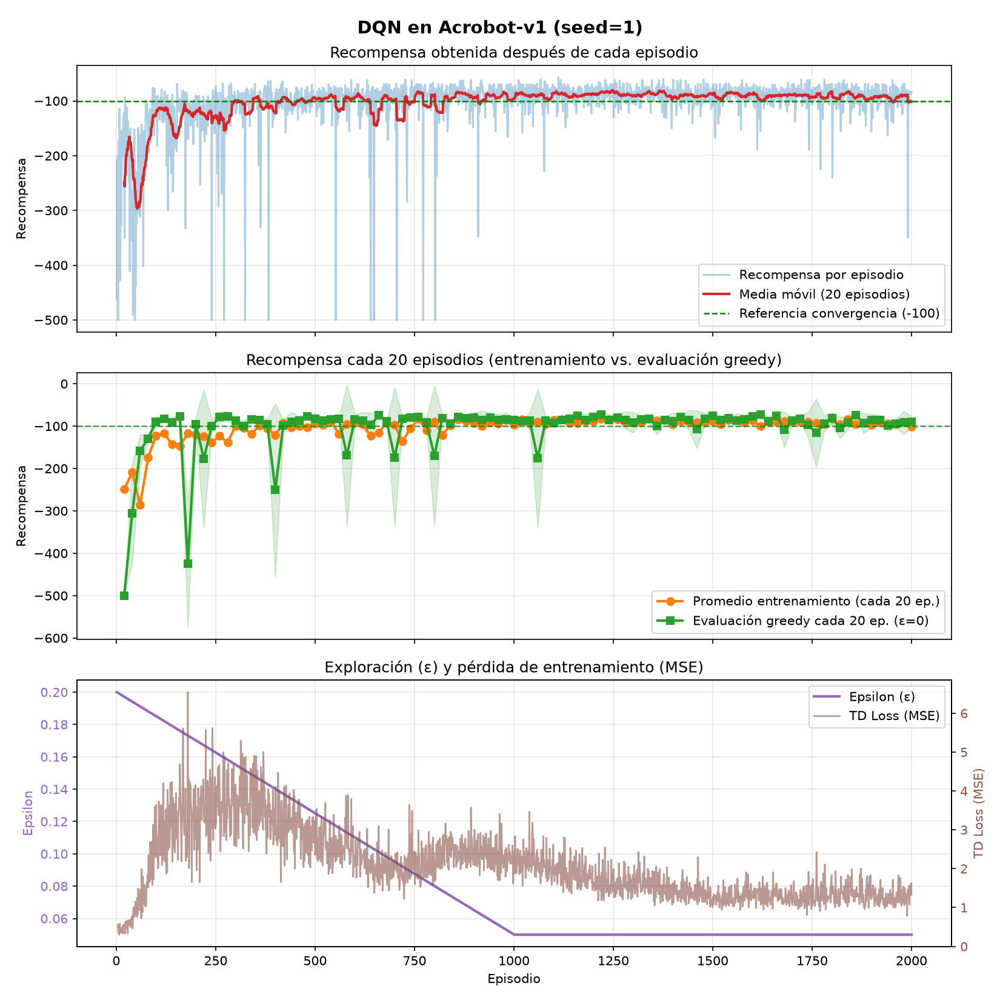

# Deep Q-Network (DQN) on Gymnasium `Acrobot-v1`

This repository contains a complete, self-contained PyTorch implementation of **Deep Q-Network (DQN)** trained on Gymnasium's `Acrobot-v1` environment ([`dqn_acrobot.py`](dqn_acrobot.py)), adapted from [CleanRL's `dqn.py`](https://github.com/vwxyzjn/cleanrl/blob/master/cleanrl/dqn.py) and benchmarked hyperparameters from [`cleanrl/Acrobot-v1-dqn-seed1`](https://huggingface.co/cleanrl/Acrobot-v1-dqn-seed1).

---

## 1. The Environment: `Acrobot-v1`

### Goal
`Acrobot-v1` simulates a two-link planar robotic arm (an underactuated double pendulum) hanging straight down under gravity. Only the **inner joint** between the two links is actuated (can apply torque), while the top pivot rotates freely.

The agent's objective is to **swing the free end of the lower link above a target height** (specifically $-\cos(\theta_1) - \cos(\theta_1 + \theta_2) > 1.0$) in **as few timesteps as possible**. Because the system is underactuated, the agent cannot simply lift the arm directly; it must learn to pump energy back and forth to build momentum before swinging up.

### Observation Space (`Box(6,)`)
At each step, the environment provides a 6-dimensional continuous state vector:

| Index | Feature | Description |
| :---: | :--- | :--- |
| 0 | $\cos(\theta_1)$ | Cosine of the first joint angle |
| 1 | $\sin(\theta_1)$ | Sine of the first joint angle |
| 2 | $\cos(\theta_2)$ | Cosine of the second joint angle (relative to the first link) |
| 3 | $\sin(\theta_2)$ | Sine of the second joint angle (relative to the first link) |
| 4 | $\dot{\theta}_1$ | Angular velocity of the first link |
| 5 | $\dot{\theta}_2$ | Angular velocity of the second link |

Representing angles with $(\cos \theta, \sin \theta)$ avoids the discontinuity at $\pm\pi$ that raw angles suffer from, making function approximation much smoother for a neural network.

### Action Space (`Discrete(3)`)
| Action | Meaning |
| :---: | :--- |
| `0` | Apply `-1` torque to the actuated joint |
| `1` | Apply `0` torque (coast) |
| `2` | Apply `+1` torque to the actuated joint |

### Rewards & Termination
- **Step reward:** `-1` at every step the goal height has not yet been reached, and `0` on the terminal step when the goal is reached.
- **Episode limit (truncation):** Maximum of **500 steps** per episode (a random agent that fails to swing up receives `-500`).
- **Convergence benchmark:** Solving `Acrobot-v1` means minimizing the number of steps to swing up. A well-trained DQN agent typically converges to an average return between **`-75` and `-100`** (i.e., reaching the target height in ~75–100 steps).

---

## 2. Neural Network Architecture (`QNetwork`)

The Q-value approximator `QNetwork` follows the exact multi-layer perceptron (MLP) architecture from CleanRL's `dqn.py`:

```text
Input (obs_dim = 6)
   │
   ▼
Linear(6 → 120) + ReLU
   │
   ▼
Linear(120 → 84) + ReLU
   │
   ▼
Linear(84 → 3)  ──►  [Q(s, a=0), Q(s, a=1), Q(s, a=2)]
```

### Why this architecture?
- **Vector input, no CNN needed:** Unlike Atari environments, `Acrobot-v1` exposes a compact 6-feature physical state vector, so fully connected layers are the natural choice.
- **Balanced capacity:** Two hidden layers of `120` and `84` units (~11,300 parameters total) provide enough nonlinearity to model the continuous double-pendulum dynamics and value landscape while remaining lightweight enough to train quickly on CPU without overfitting small replay batches.
- **Action-value output head:** Outputting all 3 action values simultaneously in a single forward pass lets the agent compute $\arg\max_a Q(s, a)$ and $\max_{a'} Q_{\text{target}}(s', a')$ efficiently.
- **Dual-network design (Online + Target):** The script maintains two identical instances:
  - `q_network`: actively updated via gradient descent.
  - `target_network`: periodically synchronized from `q_network` and held fixed in between to compute stable Bellman targets, preventing the "moving target" feedback loop that destabilizes naive Q-learning with neural networks.

---

## 3. Hyperparameter Selection & Rationale

All core hyperparameters are taken directly from CleanRL's verified benchmark run [`cleanrl/Acrobot-v1-dqn-seed1`](https://huggingface.co/cleanrl/Acrobot-v1-dqn-seed1), with the episode count and epsilon decay horizon calibrated so the episode-based loop converges reliably within a reasonable CPU runtime:

| Hyperparameter | Value | Why this value was selected |
| :--- | :---: | :--- |
| `learning_rate` | `2.5e-4` | CleanRL's default Adam step size for classic control. Large enough to make steady progress on `Acrobot-v1`, small enough to avoid Q-value divergence when target values shift. |
| `gamma` | `0.99` | High discount factor is essential in `Acrobot-v1` because every step yields `-1` and the agent must plan dozens of pumping steps ahead to achieve the swing-up. |
| `buffer_size` | `10_000` | Stores enough diverse state-action transitions to break temporal correlation between consecutive steps while remaining fresh enough that stale random trajectories are replaced as the policy improves. |
| `batch_size` | `128` | Larger than the classic Atari batch size of 32; produces lower-variance gradient estimates for compact low-dimensional states and runs very fast on CPU/GPU. |
| `learning_starts` | `10_000` | Pure exploration warm-up before the first gradient step (~20 full episodes of 500 steps). Ensures the replay buffer is filled with diverse trajectories before training begins, preventing early overfitting to a few states. |
| `train_frequency` | `10` | Performs 1 gradient update every 10 environment steps. Controls the update-to-data (UTD) ratio, keeps training stable, and makes CPU runs fast while still converging cleanly. |
| `target_network_frequency` | `500` | Copies online weights to the target network every 500 environment steps (roughly every 1–6 episodes depending on skill). Frequent enough to propagate improved Q-values, slow enough to keep TD targets stable. |
| `tau` | `1.0` | Hard update ($\theta_{\text{target}} \leftarrow \theta$). Matches the original DQN paper and CleanRL's `Acrobot-v1-dqn-seed1`. Configurable via CLI (e.g., `tau = 0.005` with `target_freq = 1`) for Polyak soft updates. |
| `start_e` / `end_e` | `1.0` → `0.05` | Starts with 100% random exploration to discover swing-up dynamics, then anneals down to a small `5%` exploration floor so the agent keeps refining its policy without getting stuck. |
| `exploration_fraction` | `0.5` | Linearly decays $\epsilon$ across the first 50% of training episodes (episodes 1–300 out of 600), leaving the second half at $\epsilon = 0.05$ to consolidate and stabilize the converged policy. |
| `num_episodes` | `600` | Runs ~100,000 environment steps total (~50 seconds on CPU), giving sufficient time to pass warm-up, complete epsilon decay, and verify sustained convergence after episode 300. |
| `eval_every` / `eval_episodes` | `20` / `5` | Logs block averages and runs 5 greedy ($\epsilon = 0$) evaluation episodes every 20 training episodes to track true policy quality separately from exploration noise. |
| `seed` | `1` | Matches `cleanrl/Acrobot-v1-dqn-seed1` for deterministic reproducibility across runs. |

---

## 4. How the Training Works

Unlike CleanRL's flat `for global_step in range(total_timesteps)` vectorized loop, [`dqn_acrobot.py`](dqn_acrobot.py) uses an **explicit episode-by-episode loop** (`for episode in range(1, cfg.num_episodes + 1)`) so the full lifecycle of each episode is transparent and easy to extend.

For each episode:
1. **Reset & Exploration Rate:** Reset `Acrobot-v1` with a deterministic episode seed (`seed + episode`) and compute the episode's exploration probability $\epsilon$ via `linear_schedule`.
2. **Environment Interaction (`while not done`):**
   - Select action $a_t$ using an **$\epsilon$-greedy policy**: random action with probability $\epsilon$, otherwise $\arg\max_a Q_\theta(s_t, a)$ under `torch.no_grad()`.
   - Step the environment to observe $(s_{t+1}, r_t, \text{terminated}, \text{truncated})$.
   - Store $(s_t, a_t, r_t, s_{t+1}, \text{terminated})$ in `ReplayBuffer`.
3. **Gradient Update (after warm-up):**
   - Once `global_step >= learning_starts` and `len(replay_buffer) >= batch_size`, every `train_frequency` steps:
     - Sample a uniform random minibatch of `128` transitions from the replay buffer.
     - Compute the one-step Bellman TD target with the frozen `target_network`:
       $$y_i = r_i + \gamma \max_{a'} Q_{\theta^-}(s'_i, a') \cdot (1 - \text{terminated}_i)$$
     - Extract the predicted Q-values for the actions actually taken: $Q_\theta(s_i, a_i)$ using `.gather(1, b_actions)`.
     - Minimize the Mean Squared Error loss (`F.mse_loss(old_val, td_target)`) via Adam.
4. **Target Network Sync:**
   - Every `target_network_frequency` steps, update `target_network` parameters with $\theta^- \leftarrow \tau \theta + (1 - \tau)\theta^-$.
5. **Periodic Logging & Greedy Evaluation (every 20 episodes):**
   - Record the mean training return over the last 20 episodes.
   - Run `evaluate_policy` on a separate evaluation environment with $\epsilon = 0$ for 5 episodes to measure mean and standard deviation of the pure greedy policy.
6. **Artifacts Saved:**
   - Periodic weight checkpoints every `checkpoint_every` episodes (default: `50`) under `checkpoints/dqn_acrobot_epXXXX.pt`.
   - Best-performing Q-network weights (`dqn_acrobot_best.pt`), automatically updated whenever greedy evaluation improves (or if not saved yet).
   - Final trained Q-network weights (`dqn_acrobot.pt`).
   - Three-panel diagnostic plot (`dqn_acrobot_rewards.png`).

---

## 5. Key Script Design Decisions

1. **Distinguishing `terminated` vs. `truncated` (Proper Bootstrapping):**
   In Gymnasium, an episode ends when either `terminated` (the acrobot reached the target height) **or** `truncated` (the 500-step time limit expired). In `ReplayBuffer.add`, only `terminated` is stored in the `dones` mask. If `truncated` were treated as terminal, the Bellman target would zero out future value at step 500 even though the state itself is not physically terminal, biasing the Q-function.
2. **Custom NumPy `ReplayBuffer` (No `stable-baselines3` Dependency):**
   CleanRL's original script imports `ReplayBuffer` from `stable-baselines3`. Here, a clean, pre-allocated circular NumPy buffer is implemented directly inside `dqn_acrobot.py` so the project stays lightweight (requiring only `gymnasium`, `torch`, `numpy`, and `matplotlib`) and every line of the algorithm is visible.
3. **Episode-Scoped Linear $\epsilon$-Decay:**
   CleanRL anneals $\epsilon$ over `0.5 * 500_000 = 250_000` timesteps. Because `dqn_acrobot.py` iterates over a configurable number of episodes (`600` by default, ~100k steps), tying `exploration_fraction` to `num_episodes` guarantees that $\epsilon$ always reaches `end_e = 0.05` halfway through the run instead of staying stuck at high randomness when running fewer episodes.
4. **Separate Training vs. Greedy Evaluation Metrics:**
   During training, $\epsilon$-greedy random actions introduce artificial noise into episode returns. Evaluating the greedy policy (`ε = 0`) every 20 episodes reveals both when the agent actually learns the swing-up and any early greedy-policy instability caused by hard target updates.
5. **Three-Panel Diagnostic Plotting (`plot_training_results`):**
   - **Panel 1:** Raw return after every episode + 20-episode moving average + `-100` convergence reference line.
   - **Panel 2:** Average training return per 20-episode block alongside greedy evaluation return (± 1 std shaded band).
   - **Panel 3:** Exploration rate ($\epsilon$) and per-episode MSE TD loss on dual axes to diagnose learning dynamics.
6. **Dataclass Config + CLI Interface:**
   All hyperparameters live in `DQNConfig` and are exposed through `argparse`, making it straightforward to run ablations (e.g., changing `--train-frequency`, `--learning-starts`, `--tau`, `--episodes`, or `--seed`) without editing code.

---

## 6. Observed Results (Default 600-Episode Run, `seed=1`)

Running `dqn_acrobot.py` with default parameters on CPU (~103,502 total steps, ~50 seconds) achieves stable convergence:

- **Episode 20:** Train(20ep) `-500.00` | Eval greedy `-500.00 ± 0.00` (end of warm-up)
- **Episode 120:** Train(20ep) `-235.00` | Eval greedy `-83.40 ± 17.15` (first strong swing-up policies)
- **Episode 300:** Train(20ep) `-95.40` | Eval greedy `-76.60 ± 8.28` ($\epsilon$ reaches `0.05`)
- **Episode 600:** Train(20ep) `-93.25` | Eval greedy `-79.40 ± 6.37` (sustained convergence from Ep 300–600)



---

## 7. How to Run

### Requirements
```bash
pip install gymnasium torch numpy matplotlib
```

### Default Run
```bash
python dqn_acrobot.py
```

### Example Custom Experiments
```bash
# Headless run (saves plot without opening a window)
python dqn_acrobot.py --no-show

# More sample-intensive training (faster per-episode convergence)
python dqn_acrobot.py --episodes 400 --train-frequency 4 --learning-starts 2000 --seed 1

# Soft target updates (Polyak averaging)
python dqn_acrobot.py --episodes 600 --tau 0.005 --target-freq 1

# Custom checkpoint interval and output paths
python dqn_acrobot.py --no-show --checkpoint-every 50 --checkpoint-dir checkpoints --best-model-path dqn_acrobot_best.pt

# Resume training from dqn_acrobot_best.pt (if it exists; otherwise starts fresh)
python dqn_acrobot.py --resume --episodes 200 --no-show

# Resume training from a specific checkpoint or model file
python dqn_acrobot.py --load-model dqn_acrobot.pt --episodes 200 --no-show
```

### Watching the Environment & DQN in Live Action (`watch_dqn.py`)
Use [`watch_dqn.py`](watch_dqn.py) to open an interactive window that renders the `Acrobot-v1` double pendulum step-by-step alongside the DQN's chosen torque action (`-1`, `0`, `+1`), live Q-value bar chart, and tip height progress toward the `1.0` goal line:

```bash
# Live interactive dashboard (automatically loads dqn_acrobot_best.pt or dqn_acrobot.pt)
python watch_dqn.py

# Watch a specific checkpoint (e.g., compare early vs. converged behavior)
python watch_dqn.py --model checkpoints/dqn_acrobot_ep0100.pt --fps 15

# Compare against an untrained random agent
python watch_dqn.py --random

# Native Gymnasium Pygame window + console action/Q-value log
python watch_dqn.py --mode human

# Export an episode to an animated GIF (great for slides/reports)
python watch_dqn.py --episodes 1 --save-gif acrobot_demo.gif --headless
```

---

## 8. References & Links

- **Original DQN Paper:** Mnih et al. (2013), *Playing Atari with Deep Reinforcement Learning* — https://arxiv.org/pdf/1312.5602
- **CleanRL Reference Script:** https://github.com/vwxyzjn/cleanrl/blob/master/cleanrl/dqn.py
- **CleanRL Benchmark Hyperparameters (`Acrobot-v1`):** https://huggingface.co/cleanrl/Acrobot-v1-dqn-seed1
- **Project Colab Notebook:** https://colab.research.google.com/drive/1pNA22KwiHcLFymrv6XLboaYn9R_nwaVj?usp=sharing

# colab Pacman PPO:
https://colab.research.google.com/drive/1pNA22KwiHcLFymrv6XLboaYn9R_nwaVj?usp=sharing
